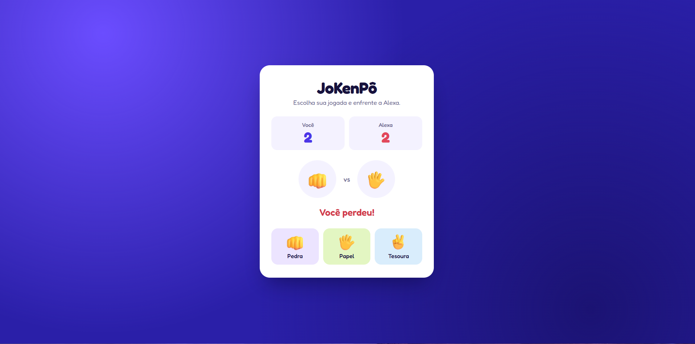

✊ Jokenpô - Pedra, Papel e Tesoura

📌 Sobre o projeto

Este projeto consiste no desenvolvimento de um jogo de Jokenpô (Pedra, Papel e Tesoura), utilizando HTML, CSS e JavaScript.

O objetivo é permitir que o usuário jogue contra o computador, escolhendo entre pedra, papel ou tesoura. O sistema realiza a comparação das escolhas e apresenta o resultado da rodada, indicando vitória, derrota ou empate.

O projeto foi desenvolvido com o intuito de praticar conceitos fundamentais de desenvolvimento web, lógica de programação e manipulação do DOM.

🚀 Tecnologias utilizadas

HTML5: Estruturação dos elementos da página.

CSS3: Estilização, layout e apresentação visual do jogo.

JavaScript: Lógica do jogo, geração de escolhas aleatórias e interação com o usuário.

🎮 Funcionalidades

Escolher entre pedra, papel ou tesoura.

Computador realiza uma escolha aleatória.

Comparação automática das jogadas.

Identificação de vitória, derrota ou empate.

Exibição do resultado de cada rodada.

📷 Demonstração

📚 Aprendizados

Durante o desenvolvimento deste projeto, pratiquei:

Manipulação do DOM com JavaScript.

Utilização de funções e estruturas condicionais.

Geração de valores aleatórios com Math.random().

Eventos de clique (addEventListener).

Estruturação de páginas com HTML.

Estilização e organização de elementos com CSS.

👨‍💻 Desenvolvedor

Luís Felipe Da Silva

Projeto desenvolvido para fins de aprendizado e prática em desenvolvimento web.